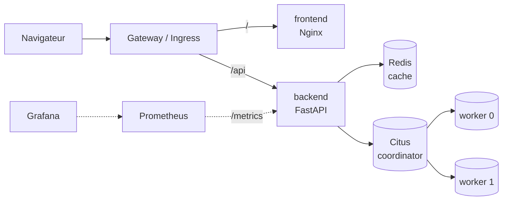

# Architecture

## Vue d'ensemble

Le point d'entrée (HTTPRoute en production, Ingress Traefik ailleurs) aiguille les requêtes selon leur chemin : `/api` vers le backend, tout le reste vers le frontend. Les deux sont donc servis sous le même domaine, ce qui évite toute configuration CORS et permet au cookie de session de fonctionner sans réglage particulier.

## Trajet d'une requête

Affichage de la bibliothèque d'un utilisateur connecté :

1. Le navigateur charge `library.html` et ses scripts depuis un pod **frontend**.
2. Le script appelle `GET /api/photos` ; le cookie `session` accompagne la requête.
3. Un pod **backend**, quel qu'il soit, vérifie la session : d'abord dans **Redis**, puis dans la base si l'entrée n'est pas en cache.
4. Le backend cherche la liste des photos dans Redis. En cas d'absence, il interroge le **coordinator Citus**, qui transmet la requête au seul **worker** contenant le shard de cet utilisateur, puis le backend remplit le cache.
5. Le navigateur affiche la galerie et charge chaque image via `GET /api/photos/{id}/content`. Les réponses sont mises en cache par le navigateur, car une photo ne change jamais.

## Composants

| Composant | Type Kubernetes | Réplicas | Rôle |
|---|---|---|---|
| `frontend` | Deployment | 2 | Pages statiques (Nginx) |
| `backend` | Deployment | 3 en production, 2 à 8 (HPA) en dev et en test | API REST |
| `redis` | Deployment | 1 | Cache partagé entre les pods backend |
| `citus-coordinator` | StatefulSet | 1 | Point d'entrée SQL, planification des requêtes distribuées |
| `citus-worker` | StatefulSet | 2 | Stockage des shards |

Le backend est **sans état** : sessions et données sont en base, le cache dans Redis. N'importe quel pod peut traiter n'importe quelle requête, ce qui permet d'ajouter ou de remplacer des pods à tout moment, que ce soit pour l'autoscaling ou pour un rolling update.

## Organisation du dépôt

| Dossier | Contenu |
|---|---|
| `backend/` | API FastAPI, migrations Alembic, tests |
| `frontend/` | Pages HTML, CSS, JavaScript et configuration Nginx |
| `k8s/base/` | Manifests communs à tous les environnements |
| `k8s/components/citus/` | Base de données, ajoutée par les overlays |
| `k8s/overlays/{dev,test,prod}/` | Spécificités de chaque environnement |
| `k8s/tasks/` | Pods ponctuels : initialisation de Citus, migrations |
| `scripts/` | Déploiement, smoke test, test de charge, contrôle de disponibilité |
| `platform/` | Configuration de Prometheus et Grafana, dashboards |
| `.github/workflows/` | Pipeline CI/CD et publication de la documentation |
