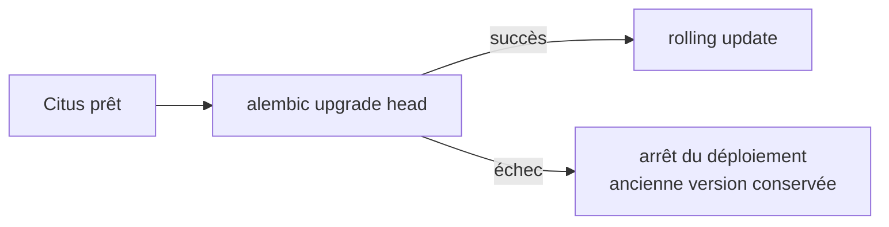

# Migrations de schéma

## Outil et exécution

Les migrations sont écrites avec **Alembic** et versionnées dans `backend/migrations/versions/`. À chaque déploiement, elles s'exécutent dans le Pod ponctuel `db-migrate` (`k8s/tasks/db-migrate.yaml`) avec la **nouvelle** image backend, **avant** le rolling update :



Le schéma est donc toujours en avance sur le code, jamais en retard.

## Historique

| Version | Changement |
|---|---|
| 0001 | Schéma initial : `users` (table de référence), `photos` (distribuée par `user_id`) |
| 0002 | Ajout de `users.password_hash`, nullable |
| 0003 | Ajout de `username` et d'une séquence pour `user_id` |
| 0004 | Table `sessions`, distribuée par `token_hash` |

## Compatibilité avec le rolling update : expand / contract

Pendant un rolling update, l'ancienne et la nouvelle version du backend fonctionnent simultanément sur le même schéma. Toute migration doit donc rester compatible avec la version précédente du code. Un changement incompatible se décompose en plusieurs déploiements :

1. **Expand** : ajout de nouveaux éléments (colonne nullable ou avec valeur par défaut, nouvelle table) sans rien supprimer ni renommer.
2. **Migration du code** : déploiement de la version qui utilise le nouveau schéma, éventuellement accompagnée d'une reprise des données existantes.
3. **Contract** : dans un déploiement ultérieur, suppression des éléments devenus inutiles ou ajout des contraintes (`NOT NULL`).

La migration 0002 applique ce principe : `password_hash` est nullable, de sorte que l'ancienne version, qui ignore cette colonne, continue de créer des utilisateurs pendant la transition.

| Changement | Approche compatible |
|---|---|
| Ajouter une colonne obligatoire | L'ajouter nullable, remplir les données, puis ajouter `NOT NULL` |
| Renommer une colonne | Ajouter la nouvelle, écrire dans les deux, migrer les lectures, puis supprimer l'ancienne |
| Supprimer une colonne | Retirer d'abord son usage du code, puis la supprimer au déploiement suivant |

## Spécificités de Citus

Une nouvelle table est créée puis distribuée explicitement :

```python
op.create_table("sessions", ...)
op.execute("SELECT create_distributed_table('sessions', 'token_hash')")
```

La clé de distribution doit faire partie de la clé primaire et des contraintes d'unicité. Les migrations détectent la présence de l'extension Citus : sur un PostgreSQL classique, la distribution est simplement ignorée.

## Créer une migration

```bash
cd backend
alembic revision -m "description du changement"
```

Il reste à écrire les fonctions `upgrade()` et `downgrade()`, puis à vérifier le SQL généré :

```bash
alembic upgrade head --sql
```
