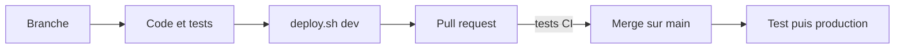

# Guide du nouveau développeur

Ce guide permet de passer d'un poste vierge à une première modification déployée.

## Jour 1 : installer et lancer

### 1. Outils

| Outil | Usage |
|---|---|
| Git | Gestion du code |
| Docker Desktop, Kubernetes activé | Cluster local |
| Helm | Installation de la plateforme |
| Python 3.12 | Tests du backend |
| Un éditeur (VS Code conseillé) | – |

### 2. Récupérer le code

```bash
git clone https://github.com/21242NS/distibuted_project.git
cd distibuted_project
```

### 3. Préparer l'environnement Python

```bash
cd backend
python3.12 -m venv .venv
source .venv/bin/activate
pip install -r requirements.txt -r requirements-dev.txt
pytest
cd ..
```

Tous les tests doivent passer avant toute modification.

### 4. Lancer le cluster et l'application

```bash
./scripts/setup-cluster.sh
./scripts/deploy.sh dev
```

Le détail de ces étapes se trouve dans [Installation du cluster local](cluster/installation-locale.md). L'application est ensuite disponible sur <http://dev.photos.localhost> et Grafana sur <http://grafana.photos.localhost>.

### 5. Lire la documentation dans cet ordre

1. [Architecture](architecture.md) : composants et trajet d'une requête
2. [API](application/api.md) : contrat entre le frontend et le backend
3. [Base de données](infrastructure/base-de-donnees.md) : règles de distribution à respecter dans les requêtes
4. [Pipeline CI/CD](pipeline.md) : ce qui se passe après un push

## Carte du code

### Backend (`backend/app/`)

| Fichier | Rôle |
|---|---|
| `main.py` | Création de l'application, routers, métriques |
| `config.py` | Toutes les variables d'environnement et leurs valeurs par défaut |
| `database.py` | Connexion SQLAlchemy et dépendance `get_db` |
| `models.py` | Modèles des tables |
| `sessions.py` | Sessions, dépendance `require_user` |
| `cache.py` | Client Redis tolérant aux pannes |
| `routers/health.py` | `/api/health`, `/api/ready` |
| `routers/login.py` | Inscription, connexion, déconnexion |
| `routers/photos.py` | Routes des photos |

### Frontend (`frontend/`)

| Fichier | Rôle |
|---|---|
| `*.html` | Pages : accueil, connexion, inscription, bibliothèque |
| `css/main.css` | Feuille de style unique, variables de couleur et d'espacement |
| `js/api.js` | Appels à l'API (`callApi`) |
| `js/session.js` | État de connexion et en-tête |
| `js/ui.js` | Notifications (`toast`) et boîtes de confirmation (`confirmDialog`) |
| `js/library.js` | Galerie, sélection, import, visionneuse |

## Cycle de développement



1. Créer une branche depuis `main` : `git switch -c feature/ma-fonctionnalite`.
2. Développer, puis lancer `pytest`.
3. Vérifier dans le cluster local : `./scripts/deploy.sh dev`.
4. Ouvrir une pull request. La CI exécute les tests, sans rien déployer.
5. Après relecture, fusionner dans `main` : la CI déploie en test, puis en production.

## Recettes

### Ajouter une route

1. Ajouter la fonction dans le router concerné (`backend/app/routers/`), ou créer un router et l'inclure dans `main.py`.
2. Protéger la route si nécessaire : `user: CurrentUser = Depends(require_user)`.
3. Filtrer toute requête sur `user.id` : c'est la clé de distribution de Citus, et la garantie qu'un utilisateur ne voit que ses données.
4. Si la route modifie des données mises en cache, supprimer les clés concernées après le commit (`cache.delete(...)`).
5. Ajouter les tests dans `backend/tests/`.

### Modifier le schéma de la base

1. `cd backend && alembic revision -m "description"`.
2. Écrire `upgrade()` et `downgrade()` en respectant l'approche [expand / contract](migrations.md) : la version actuelle du code doit continuer de fonctionner sur le nouveau schéma.
3. Pour une nouvelle table, appeler `create_distributed_table` ou `create_reference_table` si Citus est présent.
4. Mettre à jour `models.py`.
5. Déployer en dev : la migration s'exécute automatiquement avant le rolling update.

### Ajouter une variable de configuration

1. La lire dans `backend/app/config.py`, avec une valeur par défaut.
2. Si elle diffère selon l'environnement, l'ajouter dans `k8s/base/backend/deployment.yaml`, puis la surcharger dans l'overlay concerné.

### Modifier le frontend

Les fichiers sont servis tels quels par Nginx, sans étape de build. Après modification, `./scripts/deploy.sh dev` reconstruit l'image. Les messages de l'interface sont en français.

## Conventions

- Les tests passent avant chaque push ; la CI bloque le déploiement sinon.
- Aucun identifiant n'est versionné : kubeconfig, mots de passe et jetons restent hors du dépôt.
- Les images de base sont épinglées par digest ou par version.
- Toute requête sur `photos` filtre sur `user_id`.
- Les noms de variables et de fonctions sont explicites et en anglais ; les textes affichés à l'utilisateur sont en français.

## Obtenir de l'aide

| Besoin | Ressource |
|---|---|
| Un déploiement échoue | [Runbook](exploitation/runbook.md) |
| Comprendre un choix technique | [Choix techniques et limites](choix-et-limites.md) |
| Contrat de l'API | [API](application/api.md) |
