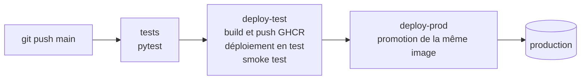

# CI/CD : du push à la production

## Vue d'ensemble



Le workflow `.github/workflows/ci-cd.yaml` se déclenche à chaque push sur `main`, sauf lorsque seuls des fichiers Markdown changent. Sur une pull request, seuls les tests s'exécutent. Le groupe de concurrence `deploy-test` garantit que deux déploiements ne s'exécutent jamais en parallèle.

## Étapes

### 1. Tests

Sur un runner hébergé par GitHub : installation des dépendances, puis `pytest`. Un échec arrête le pipeline et rien n'est déployé.

### 2. Déploiement en test

Sur le runner auto-hébergé, qui a accès au cluster de test et à celui de production :

```bash
./scripts/deploy.sh test sha-<commit>
```

1. Construction des images backend et frontend pour `linux/amd64` et `linux/arm64`, puis publication sur GHCR avec le tag `sha-<commit>`
2. Déploiement des StatefulSets Citus et initialisation du cluster
3. Migrations de schéma (`alembic upgrade head`) avec la nouvelle image
4. `kubectl apply` du rendu Kustomize, puis attente du rolling update de Redis, du backend et du frontend
5. Smoke test : santé de l'API, pages principales, scripts

### 3. Promotion en production

```bash
./scripts/promote_prod.sh sha-<commit>
```

Le script vérifie que les images existent sur GHCR, puis déploie **exactement les images validées en test**. Rien n'est reconstruit pour la production : ce qui a été testé est ce qui est livré.

Le tag `sha-<commit>` relie chaque déploiement à un commit précis. Contrairement à `latest`, il est immuable, ce qui rend chaque version identifiable et permet de revenir à n'importe laquelle.

## Gestion des échecs

Chaque étape conditionne la suivante :

| Échec | Conséquence |
|---|---|
| Tests | Aucune image construite, aucun déploiement |
| Initialisation de Citus ou migration | Le déploiement s'arrête avant `kubectl apply` : l'ancienne version continue de servir |
| Rolling update | Les nouveaux pods ne deviennent jamais prêts ; avec `maxUnavailable: 0`, les anciens restent en service |
| Smoke test en test | La production n'est pas mise à jour |

## Retour arrière

Pour revenir à une version antérieure, il suffit de promouvoir à nouveau son tag :

```bash
./scripts/promote_prod.sh sha-<commit précédent>
```

En urgence, `kubectl rollout undo deployment/backend` rétablit la révision précédente du Deployment. Une migration n'est jamais annulée automatiquement : grâce à l'approche [expand / contract](migrations.md), l'ancienne version du code fonctionne sur le nouveau schéma.

## Accès au registre

La CI s'authentifie sur GHCR avec le `GITHUB_TOKEN` éphémère du workflow, dans une configuration Docker temporaire supprimée en fin d'exécution. Aucun identifiant du registre n'est stocké sur le runner.

## Mise en place de la CI

### Runner auto-hébergé

Les jobs `deploy-test` et `deploy-prod` s'exécutent sur un runner auto-hébergé, seul à disposer du cluster de test (Docker Desktop) et des identifiants du cluster de production.

1. Sur GitHub : **Settings → Actions → Runners → New self-hosted runner**, puis suivre les commandes affichées pour télécharger et enregistrer le runner sur la machine.
2. Installer sur cette machine : Docker Desktop avec Kubernetes, `kubectl`, `jq` et Docker Buildx (fourni avec Docker Desktop).
3. Vérifier que `~/.kube/config` contient les contextes `docker-desktop` et `team3@cluster-sc`.
4. Lancer le runner en service pour qu'il redémarre avec la machine :

```bash
./svc.sh install
./svc.sh start
```

Les builds multi-architectures utilisent Buildx. Si aucun builder compatible n'existe :

```bash
docker buildx create --use --name multiarch
```

### Configuration du dépôt

| Réglage | Emplacement | Valeur |
|---|---|---|
| Permissions du workflow | `ci-cd.yaml` | `contents: read`, `packages: write` |
| Environnement de production | Settings → Environments | `production`, éventuellement avec validation manuelle (*Required reviewers*) |
| Visibilité des images | GitHub → Packages | Publique, ou Secret `imagePullSecrets` côté cluster |
| Documentation | Settings → Pages | Source : *GitHub Actions* |

Aucun secret supplémentaire n'est nécessaire : l'accès à GHCR passe par le `GITHUB_TOKEN` fourni par GitHub, et l'accès aux clusters par le kubeconfig du runner.

## Publication de la documentation

Le workflow `.github/workflows/docs.yaml` construit ce site avec MkDocs en mode strict (un lien cassé fait échouer le build) et le publie sur GitHub Pages à chaque modification de `docs/` ou de `mkdocs.yml`. Il est indépendant du déploiement de l'application.
