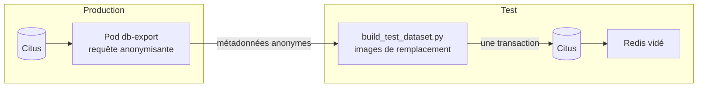

# Refresh de la base de test

L'environnement de test reçoit une copie **anonymisée** des données de production. Les tests s'exécutent ainsi sur un volume et une structure de données réalistes (nombre d'utilisateurs, répartition des photos, doublons, dates), sans qu'aucune donnée personnelle ne quitte la production.

## Utilisation

```bash
./scripts/refresh-test-db.sh
```

Le refresh peut aussi être lancé depuis GitHub : **Actions → Refresh de la base de test → Run workflow**. Le job s'exécute sur le runner auto-hébergé, dans le même groupe de concurrence que les déploiements, ce qui empêche un refresh pendant une mise à jour de l'environnement de test.

| Paramètre | Défaut | Rôle |
|---|---|---|
| Premier argument | `prod` | Environnement source : `prod`, ou `dev` pour une répétition |
| `TEST_PASSWORD` | `TestPhotos2026` | Mot de passe commun à tous les comptes de test |

```text
[INFO] 1/5 Export anonymisé depuis 'prod' (lecture seule)
[ OK ] export terminé (schéma 0004)
[INFO] 2/5 Vérification de la compatibilité des schémas
[ OK ] schéma 0004 des deux côtés
[INFO] 3/5 Construction du jeu de données
[INFO] 4/5 Remplacement des données de test (une seule transaction)
[ OK ] cache Redis vidé
[INFO] 5/5 Vérification
[ OK ] connexion de user_1 réussie
[ OK ] Base de test rafraîchie : http://test.photos.localhost
```

Après le refresh, chaque compte s'appelle `user_<id>` et utilise le mot de passe de test.

## Fonctionnement



| Étape | Où | Détail |
|---|---|---|
| 1. Export | Production | Le Pod `db-export` (`k8s/tasks/db-export.yaml`) lit la base dans une transaction `REPEATABLE READ READ ONLY` : il ne peut rien modifier, et l'export est cohérent même si des utilisateurs écrivent pendant la lecture. Le Pod est supprimé à la fin |
| 2. Contrôle du schéma | Production et test | La version Alembic de l'export doit être identique à celle de la base de test |
| 3. Construction | Poste ou runner | `scripts/build_test_dataset.py` génère le SQL d'import et une image de remplacement par photo |
| 4. Import | Test | `TRUNCATE` puis `COPY` dans **une seule transaction**, puis vidage du cache Redis |
| 5. Vérification | Test | Smoke test et connexion d'un compte importé |

L'export passe par les journaux du Pod, la seule voie de sortie disponible avec les droits du compte de production. Comme il ne contient que des métadonnées, sa taille reste de l'ordre d'une centaine d'octets par photo.

## Anonymisation

L'anonymisation est réalisée **à la source**, par la requête SQL exécutée en production. Les données personnelles ne sont jamais lues hors de la base de production, ni transférées, ni écrites sur disque.

| Donnée | En production | En test |
|---|---|---|
| Identifiant utilisateur | Conservé | Conservé, pour garder la répartition des shards |
| Nom d'utilisateur | Personnel | `user_<id>` |
| E-mail, nom | Personnels | Vides |
| Mot de passe | Hash Argon2 | Hash Argon2 du mot de passe de test, calculé par le backend de test |
| Sessions | Jetons actifs | Aucune |
| Identifiant de photo | UUID aléatoire | Conservé |
| Date d'import | Conservée | Conservée |
| Nom de fichier | Personnel | `photo-<n>.png` |
| Contenu de l'image | Personnel | Image PNG de remplacement 320 × 240 |
| Empreinte SHA-256 | Dérivée du contenu | Non exportée |

### Conservation des doublons

L'empreinte des photos n'est pas exportée. La requête la remplace par un numéro de groupe par utilisateur (`dense_rank() OVER (PARTITION BY user_id ORDER BY sha256)`) : deux photos identiques reçoivent le même numéro. En test, chaque groupe produit la même image de remplacement, donc la même empreinte. La détection des doublons se comporte exactement comme en production.

La couleur de chaque image est dérivée de l'utilisateur et du numéro de groupe : la galerie reste lisible et les doublons se reconnaissent à l'œil.

## Garde-fous

| Risque | Protection |
|---|---|
| Écraser la production | La cible est figée sur le namespace `test` du cluster local ; le script refuse toute autre cible |
| Modifier la production | Transaction en lecture seule ; aucune commande d'écriture n'est envoyée à la production |
| Export tronqué | Le script exige le marqueur de fin et un Pod terminé en `Succeeded` ; sinon la base de test n'est pas touchée |
| Schémas incompatibles | Refus si les versions Alembic diffèrent ; il faut d'abord déployer la même version en test |
| Import partiel | Import dans une transaction unique : en cas d'erreur, la base de test reste dans son état précédent |
| Cache incohérent | Redis est vidé après l'import |
| Données personnelles sur le poste | Seules des métadonnées anonymes transitent ; le dossier temporaire est supprimé à la fin, même en cas d'échec |

## Limites

- La taille réelle des fichiers n'est pas reproduite : toutes les images de remplacement pèsent environ 1 Ko. Les tests de performance sur le transfert des images doivent tenir compte de cet écart.
- Le format d'origine (JPEG, GIF, WebP) est remplacé par du PNG.
